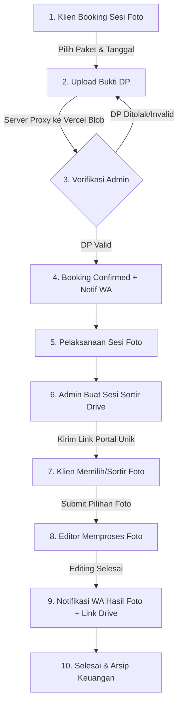

# 📸 Alur & Flow Sistem (Jadiphoto.Moment / Portal Sortir Foto)

Dokumen ini menjelaskan alur kerja (*end-to-end workflow*) aplikasi dari pemesanan oleh klien hingga pengiriman hasil foto akhir.

---

## 🗺️ Diagram Alur Utama (End-to-End Flow)

---

## 📌 Rincian 6 Tahap Alur Sistem

### 1. 📝 Pemesanan (*Booking*)
* **Aktor:** Klien
* **Halaman:** `/booking.html` (`/api/bookings`)
* **Proses:**
  1. Klien memilih kategori sesi (Wedding, Prewedding, Studio, Wisuda, dll).
  2. Klien memilih paket, tanggal acara, serta mengisi form kustom.
  3. Sistem membuat data pesanan baru dengan status `pending` / `dp_pending`.

---

### 2. 💳 Pembayaran & Upload Bukti DP
* **Aktor:** Klien
* **Halaman:** `/upload-dp.html?booking={id}` (`/api/upload/file`)
* **Proses:**
  1. Klien melihat ringkasan pesanan & nominal Down Payment (DP).
  2. Klien mengunggah file bukti transfer (JPG, PNG, PDF maks 5MB).
  3. **Arsitektur Upload:** File dikirim via `FormData` ke server Express (`multer`), lalu di-*stream* langsung ke **Vercel Blob Storage** (bebas kendala CORS).
  4. Status booking berubah menjadi `dp_review`.

---

### 3. ✅ Verifikasi Admin & Notifikasi Booking
* **Aktor:** Admin
* **Halaman:** `/admin/bookings.html` (`/api/bookings/:id/status`)
* **Proses:**
  1. Admin memverifikasi mutasi dan file bukti DP.
  2. Admin menyetujui booking (status → `confirmed`).
  3. Sistem otomatis mengirim pesan konfirmasi & detail jadwal ke nomor WhatsApp klien via WhatsApp Gateway.

---

### 4. 🖼️ Pembuatan Sesi & Sortir Foto oleh Klien
* **Aktor:** Fotografer / Admin & Klien
* **Halaman:** `/gallery.html?session={token}` (`/api/sessions`, `/api/drive`)
* **Proses:**
  1. Setelah sesi pemotretan, admin mengunggah foto preview ke Google Drive.
  2. Admin membuat sesi sortir di sistem dengan memasukkan Folder ID Google Drive.
  3. Klien menerima link portal galeri privat.
  4. Klien melihat galeri thumbnail (di-load cepat melalui caching proxy backend `/api/drive/thumbnail`).
  5. Klien memilih foto favorit sesuai kuota paket dan menambahkan catatan editing, lalu menekan **Submit Seleksi**.

---

### 5. 🎨 Editing & Notifikasi Hasil Akhir
* **Aktor:** Editor / Admin
* **Endpoint:** `/api/sessions/:id/notify-done` & `/api/notify`
* **Proses:**
  1. Editor memproses foto berdasarkan daftar pilihan klien.
  2. File hasil edit diunggah ke Google Drive final.
  3. Admin mengubah status sesi menjadi **Selesai Edit / Completed**.
  4. Sistem otomatis mengirimkan pesan WhatsApp ke klien berisi link unduh Google Drive hasil foto yang sudah diedit.

---

### 6. 📊 Manajemen Keuangan & Kategori (Admin Portal)
* **Aktor:** Admin / Owner
* **Halaman:** `/admin/dashboard.html`, `/admin/finance.html`, `/admin/categories.html`
* **Proses:**
  * **Dashboard:** Monitoring ringkasan booking aktif, sesi foto mendatang, dan status sortir.
  * **Finance:** Pencatatan otomatis pemasukan DP, pelunasan sisa tagihan, dan rekonsiliasi kas.
  * **Kategori & Paket:** Pengaturan dinamis harga paket, jumlah foto edit, dan form kustom.

---

## 🛠️ Arsitektur Teknologi & Integrasi

| Komponen | Teknologi / Layanan | Fungsi Utama |
|---|---|---|
| **Backend** | Node.js (Express.js) | REST API, Business Logic, Auth JWT |
| **Database** | PostgreSQL (Neon DB) / SQLite | Penyimpanan data booking, sesi, & keuangan |
| **File Storage** | Vercel Blob Storage | Penyimpanan bukti transfer DP & dokumen |
| **Galeri Foto** | Google Drive API + Cache Proxy | Penyimpanan & streaming thumbnail foto sesi |
| **Notifikasi** | WhatsApp API Gateway (Fonnte / Wablas) | Notifikasi real-time status booking & pengiriman hasil |
| **Frontend** | Vanilla JS, Modern CSS, HTML5 | Portal klien responsif & Dashboard admin |
