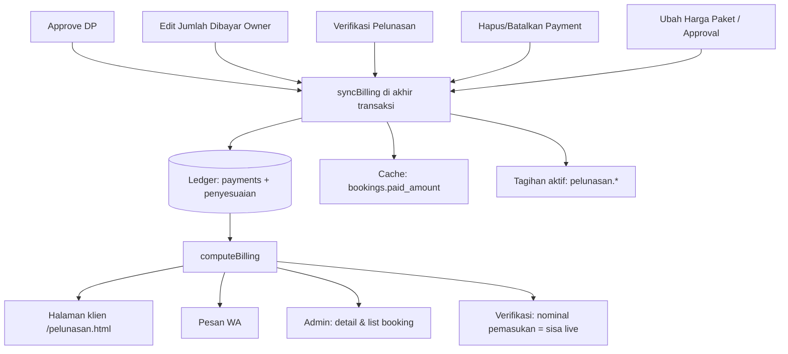

# PRD: Sistem Tagihan Terpusat (Single Source of Truth)

**Produk:** Jadiphoto.Moment
**Modul terkait:** Booking, Pelunasan, Finance, Approval
**Status:** Draft untuk eksekusi
**Dasar:** hasil pembacaan kode (`routes/bookings.js`, `routes/pelunasan.js`, `routes/finance.js`, `public/js/admin-pelunasan.js`, `public/pelunasan.html`). Nomor baris di dokumen ini adalah **jangkar awal** dan bisa bergeser; verifikasi dengan `grep -n`.

---

## 1. Masalah

Angka "berapa yang sudah dibayar" dan "berapa sisa tagihan" tersebar di tiga tempat yang tidak saling sinkron:

| Tempat | Fungsi sekarang | Siapa yang menulis |
|---|---|---|
| `bookings.paid_amount` | Angka "Jumlah Dibayar" yang diedit Owner | Edit Owner, approve DP |
| `payments` (status `approved`) | Riwayat pembayaran DP/pelunasan | Approve DP, verifikasi pelunasan |
| `pelunasan.total_tagihan / dp_terbayar / sisa_kekurangan` | Salinan angka yang dikunci saat tagihan dibuat | Hanya saat tagihan dibuat |

Akibatnya:
1. Edit "Jumlah Dibayar" hanya mengubah `paid_amount` dan `financial_entries`. Tagihan (`pelunasan`) dan halaman/WA klien tetap memakai angka lama.
2. Pembuatan tagihan menghitung DP hanya dari `payments` tipe `dp`, mengabaikan editan.
3. Verifikasi pelunasan mencatat pemasukan memakai `sisa_kekurangan` lama, sehingga total tercatat bisa tidak pas dengan harga paket.
4. Tampilan memakai `GREATEST(paid_amount, SUM(payments))`, jadi **penurunan** jumlah dibayar tidak pernah terlihat.
5. Angka "50%" bukan hardcode, melainkan `booking_categories.dp_value` (DP persen per kategori). Karena tagihan dibaca dari baris DP yang disetujui, sisa tampak selalu 50%.

## 2. Tujuan

1. **Satu fungsi** yang menjawab: total, dibayar, sisa, status bayar. Semua halaman, WA, admin, dan verifikasi memakainya.
2. Setiap perubahan pembayaran otomatis menyinkronkan angka turunan (cache booking dan tagihan aktif) **dalam transaksi yang sama**.
3. Admin/Owner dapat **melihat rincian, menelusuri asal angka, dan menghitung ulang** dari satu tempat.
4. Data lama dapat diperiksa dan dirapikan lewat laporan selisih (dry-run lebih dulu).

### Non-Goals
- Payment gateway/QRIS dinamis.
- Mengubah aturan DP per kategori (`dp_type`/`dp_value`) atau alur approval staff.
- Mengubah tampilan besar halaman; hanya blok rincian tagihan.

## 3. Prinsip Desain

1. **Ledger** = daftar pergerakan uang yang tidak dihapus-ulang: `payments` (approved) + penyesuaian Owner (`financial_entries` dengan `sumber_tipe = 'booking_adjustment'`, status `aktif`).
2. **Angka turunan tidak diedit langsung.** `bookings.paid_amount` dan kolom nominal di `pelunasan` hanya cache yang diperbarui oleh `syncBilling`.
3. **Edit "Jumlah Dibayar" = menulis selisih ke ledger** (penyesuaian), bukan menimpa kolom.
4. **Halaman klien dan WA menghitung langsung** dari ledger saat dibuka/dikirim, sehingga link lama otomatis benar.
5. Uang = **integer rupiah**. Semua query berparameter. Operasi multi-tabel dalam **satu DB transaction** dengan lock baris booking.

## 4. Algoritma Inti

```
computeBilling(bookingId):
  total   = round(bookings.package_price)            // null bila belum diisi
  pay_sum = Σ payments.amount          WHERE booking_id = ? AND status = 'approved'
  adj_sum = Σ (tipe='masuk' ? +nominal : -nominal)
            FROM financial_entries
            WHERE booking_id = ? AND sumber_tipe = 'booking_adjustment' AND status = 'aktif'
  paid    = pay_sum + adj_sum
  sisa    = (total == null) ? null : max(total - paid, 0)
  kelebihan = (total == null) ? 0 : max(paid - total, 0)
  status_bayar = paid <= 0 ? 'belum_bayar'
               : (total > 0 AND paid >= total) ? 'lunas' : 'sebagian'
  return {total, paid, sisa, kelebihan, status_bayar,
          rincian: {dp, pelunasan, lainnya, penyesuaian}}

syncBilling(client, bookingId, userId):          // dipanggil di akhir SETIAP penulisan pembayaran
  lock booking FOR UPDATE
  b = computeBilling(bookingId)
  UPDATE bookings SET paid_amount = b.paid, version = version + 1
  terapkan aturan status booking (lihat 6)
  UPDATE pelunasan                                 // hanya tagihan aktif yang belum diunggah bukti
     SET total_tagihan = b.total, dp_terbayar = b.paid, sisa_kekurangan = b.sisa
   WHERE booking_id = ? AND status IN ('sent','rejected')
  IF b.sisa == 0 THEN batalkan tagihan aktif ('sent','rejected') dengan alasan "sudah lunas"
  tagihan 'menunggu_verifikasi': JANGAN ubah, tandai needs_review bila nominal berbeda dari sisa live
  catat audit (nilai lama -> baru)

setPaidAmount(bookingId, targetPaid, userId):   // pengganti logika edit saat ini
  b = computeBilling(bookingId)
  diff = targetPaid - b.paid
  tolak jika targetPaid < 0 atau (total != null dan targetPaid > total)
  diff > 0 -> INSERT financial_entries (masuk, sumber_tipe='booking_adjustment')
  diff < 0 -> INSERT financial_entries (keluar, sumber_tipe='booking_adjustment')
  syncBilling(...)
```

Alur data:



## 5. Titik Integrasi (Jangkar Kode)

**Penulisan, wajib memanggil `syncBilling`:**

| Lokasi | Kejadian |
|---|---|
| `routes/bookings.js` ~1026-1125 (`handlePatchPaidAmount`) | Edit jumlah dibayar, diganti `setPaidAmount` |
| `routes/bookings.js` ~1401-1404 dan `services/bookingApproval.js` ~283-290, ~439 | Approve DP |
| `routes/pelunasan.js` ~620-700 (`verify`, INSERT payments ~667-671) | Verifikasi pelunasan, nominal pemasukan diambil dari sisa live |
| `routes/finance.js` ~338 | Hapus payment |
| `routes/bookings.js` ~703-731 (`set-price`), ~803-815 dan ~919-927 (PUT), `routes/approvals.js` ~296-313 | Perubahan harga/DP |

**Pembacaan, pakai `computeBilling` (atau cache yang pasti tersinkron):**

| Lokasi | Perubahan |
|---|---|
| `routes/pelunasan.js` ~83-155 (GET token), ~494-590 (send-wa) | Hitung live, jangan baca kolom basi |
| `routes/pelunasan.js` ~318-483 (POST buat tagihan) | DP/dibayar dari `computeBilling`, bukan hanya `payments` tipe `dp` |
| `routes/bookings.js` ~536-549 (list) dan ~643 (detail) | Hapus `GREATEST(...)`, pakai `paid_amount` cache / `computeBilling` |
| `public/js/admin-pelunasan.js` ~701-714, ~732-760 | Pakai nilai dibayar efektif dari API |
| `public/pelunasan.html` ~620-634 | Tampilkan nilai dari API live |

## 6. Aturan Status Booking (dipusatkan di `syncBilling`)

Pertahankan perilaku yang sudah ada, tetapi pindahkan ke satu tempat:
- `paid >= total (>0)` dan status ada di `pending_dp, dp_review, confirmed, menunggu_pelunasan` -> `lunas`.
- `paid == 0` dan status `lunas` -> `pending_dp`.
- `paid < total` dan status `lunas` -> kembali ke `confirmed` (baru; sebelumnya tidak ditangani). Konfirmasi dulu ke owner (Open Question 2).
- Status lain tidak disentuh.

## 7. Requirement Fungsional

- **FR1** Modul `services/billing.js` berisi `computeBilling`, `syncBilling`, `setPaidAmount`. Tidak ada perhitungan sisa/dibayar di luar modul ini.
- **FR2** Semua titik penulisan di Bagian 5 memanggil `syncBilling` **di dalam transaksi yang sama**.
- **FR3** Halaman klien dan WA menampilkan Total, Dibayar, Sisa dari `computeBilling` saat dibuka/dikirim.
- **FR4** Edit jumlah dibayar bisa **menaikkan maupun menurunkan** dan hasilnya langsung terlihat di semua tampilan.
- **FR5** Tagihan aktif (`sent`/`rejected`) ikut diperbarui; bila sisa menjadi 0 otomatis dibatalkan; tagihan `menunggu_verifikasi` ditandai `needs_review`, tidak diubah diam-diam.
- **FR6** Verifikasi pelunasan mencatat pemasukan sebesar **sisa live** saat verifikasi, dengan pengecekan kelebihan.
- **FR7** Blok **"Rincian Tagihan"** di detail booking admin: total, dibayar (rincian DP/pelunasan/penyesuaian), sisa, status, daftar riwayat; tombol **"Hitung Ulang"** (owner) memanggil `syncBilling`.
- **FR8** Skrip laporan selisih `scripts/billing-reconcile.js`: default **dry-run**, `--apply` hanya memperbaiki yang dapat diturunkan (cache basi, snapshot tagihan basi); kasus lain ditandai `NEEDS_REVIEW`.
- **FR9** Setiap sinkronisasi tercatat di audit (siapa, kapan, nilai lama dan baru).
- **FR10** Setelah backfill, hapus pola `GREATEST(paid_amount, SUM(payments))` di list/detail.

## 8. Edge Case

- `package_price` kosong: `sisa = null`, tampilkan "Harga belum diisi", tidak membuat tagihan.
- `paid > total` lewat payment: tampilkan `kelebihan`; edit manual yang melebihi total tetap ditolak (perilaku saat ini).
- Dua admin mengedit bersamaan: lock `FOR UPDATE` pada baris booking di awal `syncBilling`.
- Booking dibuat manual oleh admin dengan `dp_amount` tetapi tanpa baris `payments`: ledger = 0, dilaporkan `NEEDS_REVIEW`; perbaiki lewat edit jumlah dibayar (menghasilkan penyesuaian yang benar).
- Pembatalan booking (`bookings.js` ~1253 menandai `financial_entries` `batal`): penyesuaian ber-status `batal` tidak dihitung ledger.
- Penyesuaian dihitung hanya dari `sumber_tipe = 'booking_adjustment'` agar tidak menghitung ganda entri keuangan lain yang berasal dari payment yang sama. **Verifikasi di Fase 0.**

## 9. Fase Pengerjaan

| Fase | Isi | Hasil |
|---|---|---|
| 0 | Audit singkat (verifikasi asumsi Bagian 8, struktur `financial_entries`, gaya tes) | Laporan <= 15 baris |
| 1 | `services/billing.js` + tes unit | Modul + tes lulus |
| 2 | Pasang `syncBilling` di semua titik penulisan | Edit DP, approve, verifikasi sinkron |
| 3 | Pasang `computeBilling` di pembacaan + halaman klien + WA + admin + blok Rincian | Semua tampilan konsisten |
| 4 | Skrip reconcile (dry-run, lalu apply setelah disetujui) | Data lama rapi |
| 5 | Bersihkan `GREATEST`, kode duplikat, dan hardcode lama | Satu sumber kebenaran |

## 10. Acceptance Criteria

1. Total 5.000.000, DP disetujui 2.500.000: sisa 2.500.000 di admin, halaman klien, dan WA.
2. Owner ubah dibayar jadi 3.000.000: sisa 2.000.000 **di semua tempat tanpa membuat ulang link**.
3. Owner **turunkan** dibayar jadi 1.500.000: sisa 3.500.000 terlihat (tidak tertahan `GREATEST`).
4. Dibayar sama dengan total: status `lunas`, tagihan aktif otomatis dibatalkan, halaman klien menampilkan lunas.
5. Verifikasi pelunasan mencatat pemasukan sama dengan sisa live; total payments + penyesuaian = harga paket.
6. Hapus payment: sisa bertambah sesuai, semua tampilan ikut berubah.
7. Gagal di tengah operasi: tidak ada data setengah tersimpan (rollback).
8. Dua edit bersamaan pada booking yang sama tidak menghasilkan angka yang saling menimpa.
9. `billing-reconcile` dry-run melaporkan daftar selisih tanpa mengubah data.
10. Tidak ada perhitungan sisa/dibayar di luar `services/billing.js`.

## 11. Risiko & Mitigasi

| Risiko | Mitigasi |
|---|---|
| Data lama tidak punya baris `payments` | Dry-run reconcile + `NEEDS_REVIEW` per booking |
| Menghitung ganda antara `payments` dan `financial_entries` | Hanya hitung `sumber_tipe='booking_adjustment'`; verifikasi di Fase 0 |
| Laporan keuangan berubah | Jangan ubah query `finance.js`; hanya tambah pemanggilan sync |
| Staff yang melewati approval engine | Titik integrasi `approvals.js` dan `bookingApproval.js` wajib memanggil sync |

## 12. Open Questions

1. Booking lama tanpa baris `payments` tetapi berstatus confirmed: dianggap DP sudah dibayar sebesar `dp_amount` (perlu entri), atau dibiarkan `NEEDS_REVIEW` sampai owner koreksi manual? (Default: `NEEDS_REVIEW`.)
2. Jika dibayar diturunkan di bawah total pada booking `lunas`: status kembali ke `confirmed` otomatis?
3. Apakah tagihan `menunggu_verifikasi` yang nominalnya berubah sebaiknya otomatis ditolak (minta unggah ulang) atau cukup ditandai untuk ditinjau admin?
