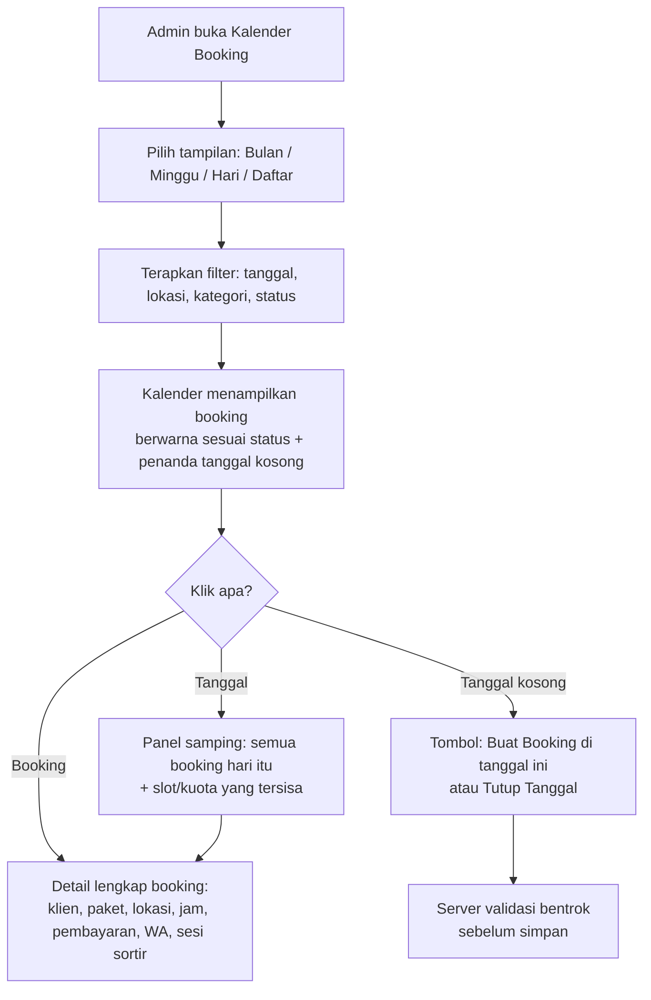

# Fitur Filter Tanggal, Jadwal Kosong, dan Kalender Booking

Isi file: **Bagian A** PRD ringkas, **Bagian B** prompt AI siap salin untuk eksekusi.

---

# BAGIAN A: PRD RINGKAS

## 1. Latar Belakang & Tujuan

Admin sulit mengetahui tanggal mana yang masih kosong sebelum menerima booking baru, dan belum ada tampilan kalender yang merangkum seluruh jadwal. Risiko: bentrok jadwal (double booking) dan waktu terbuang mengecek manual.

**Tujuan:**
1. Admin dapat memfilter data booking berdasarkan tanggal (hari, rentang, atau bulan).
2. Admin dapat melihat **tanggal/slot yang masih kosong** dengan cepat.
3. Admin memiliki **tampilan kalender** (bulan/minggu/hari) yang bisa dibuka sampai detail booking lengkap.
4. Sistem **mencegah bentrok** saat booking dibuat atau diubah.

## 2. User Story

- Sebagai admin, saya ingin memilih tanggal atau rentang tanggal dan langsung melihat booking apa saja pada periode itu.
- Sebagai admin, saya ingin melihat daftar tanggal kosong (misal 60 hari ke depan) untuk menawarkan jadwal ke klien.
- Sebagai admin, saya ingin klik sebuah tanggal di kalender dan melihat seluruh detail booking hari itu tanpa pindah halaman.
- Sebagai owner, saya ingin menutup tanggal tertentu (libur, acara pribadi) agar tidak bisa dibooking.

## 3. Alur



## 4. Functional Requirements

**4.1 Filter di halaman Booking (`/admin/bookings.html`)**
- FR1 Filter tanggal acara: satu tanggal, rentang (dari-sampai), atau pilihan cepat (Hari ini, Minggu ini, Bulan ini, 30 hari ke depan).
- FR2 Dapat dikombinasikan dengan filter yang ada: status, kategori, lokasi (Solo/Jogja/Luar Kota), status pembayaran.
- FR3 Hasil filter menampilkan jumlah data dan dapat di-reset sekali klik.

**4.2 Jadwal Kosong**
- FR4 Tampilan "Tanggal Tersedia": daftar tanggal ke depan (default 60 hari) beserta sisa kuota per tanggal.
- FR5 Aturan ketersediaan dikelola owner di pengaturan: **kuota booking per hari** (default 1, bisa diubah), **jam operasional** (opsional), dan **tanggal ditutup** (libur/blokir manual dengan alasan).
- FR6 Booking yang dihitung "terisi": status pending DP, review DP, dan confirmed. Yang tidak dihitung: dibatalkan dan terhapus (soft delete). Daftar status ini mudah diubah di satu tempat.
- FR7 Ketersediaan dapat difilter per lokasi bila kuota dibedakan per lokasi (opsional, lihat Open Questions).

**4.3 Kalender**
- FR8 Tampilan **Bulan, Minggu, Hari, dan Daftar**, dengan navigasi sebelumnya/berikutnya/hari ini.
- FR9 Booking tampil sebagai penanda berwarna sesuai status (misal: menunggu DP, review, confirmed, lunas, selesai) dengan legenda warna.
- FR10 Tanggal kosong, tanggal penuh, dan tanggal ditutup dibedakan jelas secara visual (tidak hanya dengan warna: tambahkan ikon/teks agar mudah dibaca).
- FR11 Klik tanggal membuka **panel samping/modal** berisi seluruh booking hari itu dan sisa kuota.
- FR12 Klik booking membuka **detail lengkap**: nama klien, kontak WA (tautan langsung ke WhatsApp), kategori, paket, lokasi, tanggal dan jam, harga, jumlah dibayar, sisa, status, catatan, status T&C, dan tautan ke sesi sortir bila ada.
- FR13 Dari tanggal kosong, admin dapat **membuat booking baru** dengan tanggal terisi otomatis, atau **menutup tanggal**.
- FR14 Responsif di mobile (tampilan bulan menjadi ringkas, detail terbuka sebagai layar penuh).

**4.4 Pencegahan Bentrok**
- FR15 Server memvalidasi kuota dan tanggal ditutup saat **membuat dan mengubah** booking (lewat form klien maupun admin). Jika penuh, tolak dengan pesan jelas.
- FR16 Pengecekan dan penyimpanan dilakukan dalam **satu DB transaction** agar dua booking bersamaan tidak lolos bersamaan.
- FR17 Admin/owner dapat menimpa (override) kuota dengan konfirmasi eksplisit dan tercatat.

**4.5 Fase 2 (Opsional)**
- Form booking klien menonaktifkan tanggal yang penuh atau ditutup.
- Ekspor jadwal (PDF/gambar) untuk dibagikan ke tim.
- Sinkronisasi ke Google Calendar.

## 5. Data (Level Konsep)

- **bookings**: memakai kolom tanggal acara yang sudah ada (tipe DATE, tanpa jam/zona waktu) dan jam acara opsional. Tambahkan indeks pada tanggal acara.
- **schedule_settings**: kuota per hari, jam operasional, daftar status yang dihitung terisi.
- **blocked_dates**: tanggal, alasan, dibuat oleh, soft delete.

## 6. Edge Case

- Zona waktu: seluruh tanggal diproses sebagai **WIB (Asia/Jakarta)**; hindari pergeseran tanggal akibat konversi UTC.
- Booking tanpa jam: tampil sebagai "sepanjang hari".
- Acara beberapa hari (misal wedding 2 hari): bila didukung, mengisi kuota di tiap tanggal.
- Status booking berubah (dibatalkan): kuota otomatis kembali tersedia.
- Booking lama dengan tanggal kosong atau tidak valid: tidak error, tampil di daftar "Tanpa tanggal".

## 7. Acceptance Criteria

1. Memilih rentang tanggal menampilkan hanya booking pada rentang itu, dapat dikombinasikan dengan filter lain.
2. Daftar tanggal kosong akurat dan berubah saat booking dibuat, dibatalkan, atau tanggal ditutup.
3. Kalender bulan/minggu/hari/daftar berfungsi, dan klik tanggal atau booking menampilkan detail lengkap.
4. Membuat booking di tanggal yang penuh atau ditutup ditolak server, termasuk lewat request API langsung.
5. Dua permintaan simultan ke slot terakhir hanya satu yang berhasil.
6. Tampilan nyaman di mobile dan desktop.

## 8. Open Questions

1. Apakah kuota berlaku **per hari total**, atau **per lokasi** (Solo dan Jogja bisa berjalan paralel pada hari yang sama)?
2. Apakah booking memiliki jam mulai/selesai, dan perlu slot jam, atau cukup per tanggal?
3. Apakah ada lebih dari satu fotografer/tim yang menentukan kapasitas harian?

---

# BAGIAN B: PROMPT AI (SALIN BAGIAN DI BAWAH INI)

````
Kamu adalah senior fullstack dev. Tambahkan fitur filter tanggal, jadwal kosong, dan kalender booking di panel admin app booking foto saya.

STACK: Node.js Express, PostgreSQL (Neon), auth JWT, Vanilla JS/HTML/CSS, deploy Vercel.
Spesifikasi lengkap ada di file PRD-PROMPT-Kalender-Jadwal-Booking.md, Bagian A (baca hanya Bagian 4, 5, 6, 7).

ATURAN KERJA (wajib, hemat token & minim bug)
- Jangan scan seluruh repo atau rewrite file utuh. Grep dulu: skema tabel bookings (kolom tanggal acara, jam, status, kategori, lokasi, deleted_at),
  handler GET/POST/PUT bookings, /admin/bookings.html, middleware JWT, helper UI (modal, tabel), dan gaya CSS yang ada.
- REUSE komponen dan gaya yang ada. TIDAK ada library baru (bangun grid kalender sendiri dengan Vanilla JS), tidak ada refactor di luar scope.
- Kerjakan per tahap, commit terpisah, lalu berhenti dan tanya "Lanjut?" Output hanya: rencana 3-5 baris, diff minimal, hasil tes singkat.
- Jika ada asumsi penting atau konflik dengan kode yang ada, tanya SATU kali (maks 3 pertanyaan) di awal.
- Buat branch feat/kalender-booking. Jangan push, merge, atau deploy.

ATURAN LINTAS TAHAP (pencegah bug)
1. Tanggal acara diproses sebagai DATE murni zona WIB. Jangan memakai new Date(string) yang menggeser hari akibat UTC; bandingkan dan format sebagai string YYYY-MM-DD.
2. Semua query booking wajib memfilter deleted_at IS NULL; hitungan "terisi" hanya untuk status yang terdaftar di satu konstanta/pengaturan (default: pending DP, review DP, confirmed). Status dibatalkan tidak dihitung.
3. Query berparameter ($1, $2), tanpa string concat SQL. Tambahkan indeks pada kolom tanggal acara (migrasi idempotent, IF NOT EXISTS, jangan dijalankan ke produksi; beri saya perintahnya).
4. Endpoint tulis pengaturan jadwal dan tanggal ditutup: JWT + role owner di server. Escape teks yang dirender ke HTML (cegah XSS).
5. Penanda ketersediaan tidak boleh hanya mengandalkan warna: tambahkan teks/ikon.

TAHAP 1: FILTER TANGGAL (/admin/bookings.html)
- Tambah filter tanggal acara: satu tanggal, rentang dari-sampai, dan tombol cepat (Hari ini, Minggu ini, Bulan ini, 30 hari ke depan).
- Kombinasikan dengan filter status/kategori/lokasi yang sudah ada; tampilkan jumlah hasil dan tombol reset.
- Lakukan filter di server (parameter from/to pada endpoint list yang ada) dengan validasi format tanggal.

TAHAP 2: PENGATURAN & KETERSEDIAAN
- Migrasi: tabel schedule_settings (kuota per hari default 1, status yang dihitung terisi, jam operasional opsional) dan blocked_dates (tanggal, alasan, created_by, deleted_at). Seed pengaturan default idempotent.
- Endpoint: GET /api/admin/availability?from&to[&location] mengembalikan per tanggal: {date, booked, quota, remaining, blocked, reason}. Hitung di server dalam satu query agregasi.
- Endpoint owner: kelola kuota dan tutup/buka tanggal.
- UI: panel "Tanggal Tersedia" (default 60 hari ke depan) berisi tanggal kosong beserta sisa kuota.

TAHAP 3: KALENDER
- Halaman/tab "Kalender" di admin: tampilan Bulan, Minggu, Hari, Daftar; navigasi sebelumnya/berikutnya/hari ini; legenda status.
- Satu endpoint GET /api/admin/calendar?from&to[&filters] mengembalikan data ringkas booking + tanggal ditutup untuk rentang tampilan (jangan memuat semua booking sekaligus).
- Klik tanggal: panel samping/modal daftar booking hari itu + sisa kuota. Klik booking: detail lengkap (klien, tautan WA, kategori, paket, lokasi, tanggal/jam, harga, dibayar, sisa, status, catatan, status T&C bila ada, tautan sesi sortir bila ada). Reuse tampilan detail booking yang sudah ada bila tersedia.
- Dari tanggal kosong: tombol "Buat Booking" (tanggal terisi otomatis) dan "Tutup Tanggal" (owner).
- Responsif mobile: bulan ringkas, detail layar penuh. Navigasi keyboard dan fokus yang jelas.

TAHAP 4: PENCEGAHAN BENTROK
- Pada POST/PUT booking (form klien maupun admin): dalam 1 DB transaction, kunci/hitung booking pada tanggal tersebut (misal pg_advisory_xact_lock berdasarkan tanggal atau SELECT ... FOR UPDATE) lalu tolak 409 dengan pesan jelas jika kuota penuh atau tanggal ditutup.
- Override oleh owner/admin hanya dengan flag eksplisit dan konfirmasi di UI; catat siapa yang melakukannya.
- Jangan mengubah alur lain di form booking klien (penonaktifan tanggal penuh di form klien adalah Fase 2, kecuali saya minta).

CHECKLIST AKHIR (laporkan pass/fail singkat)
- [ ] Filter rentang tanggal benar, dan tanggal tidak bergeser sehari (uji tanggal 1 dan akhir bulan).
- [ ] Booking dibatalkan/terhapus tidak mengurangi ketersediaan; kuota kembali otomatis.
- [ ] Daftar tanggal kosong akurat dan berubah setelah booking dibuat atau tanggal ditutup.
- [ ] Kalender 4 tampilan berfungsi; klik tanggal dan booking menampilkan detail lengkap.
- [ ] Booking ke tanggal penuh/ditutup ditolak 409, termasuk via request API langsung.
- [ ] Dua request bersamaan ke slot terakhir: hanya satu berhasil.
- [ ] Non-owner tidak bisa mengubah kuota atau menutup tanggal (403).
- [ ] Booking lama tanpa tanggal tidak membuat error.

OUTPUT: Pertanyaan (jika perlu) -> Tahap 1 -> 2 -> 3 -> 4, masing-masing: Rencana -> Patch -> Cara tes.
````

---

## Catatan Penggunaan (tidak perlu disalin ke AI)

- **Putuskan dulu Open Questions** (kuota per hari atau per lokasi, ada slot jam atau tidak). Ini menentukan desain data, jadi lebih murah dijawab sebelum coding.
- **Backup dulu:** snapshot atau branch database Neon sebelum menjalankan migrasi.
- **Urutan di sistem kamu:** kerjakan setelah CRUD Admin Owner dan perbaikan `PUBLIC_BASE_URL`, karena detail booking di kalender memakai data status pembayaran dan tautan WA/sesi.
- Jika AI tidak punya akses repo, tempelkan hanya: skema `bookings`, handler list/create booking, dan potongan `/admin/bookings.html`.
