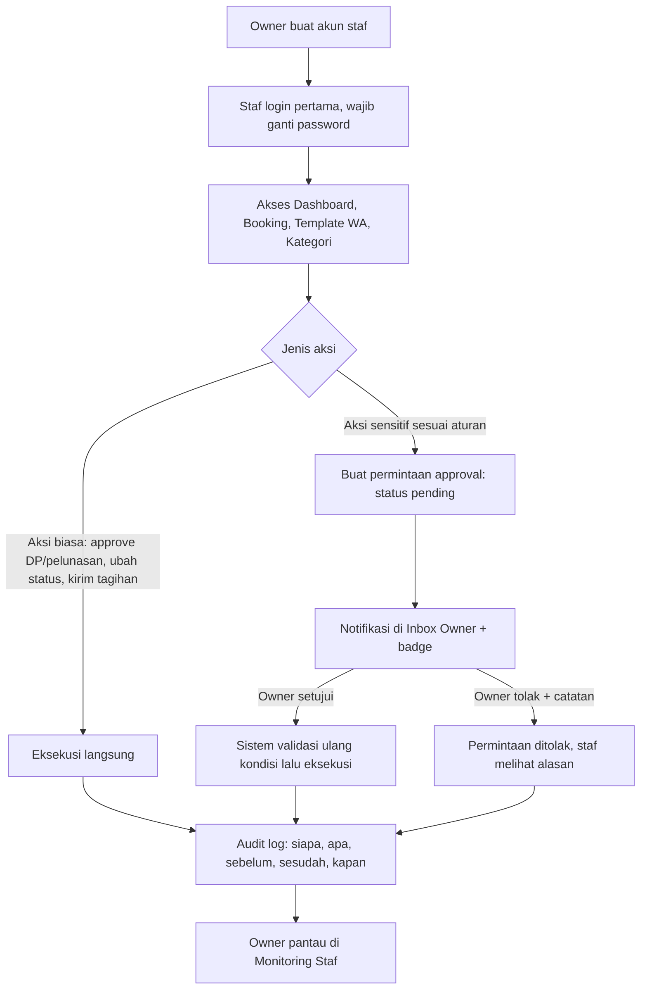

# 👥 Scale-Up PRD: Akun Staff, Hak Akses & Approval Tracking (Jadiphoto.Moment)

Lanjutan dari PRD singkat. Dokumen ini adalah spesifikasi yang cukup detail untuk langsung dieksekusi, dan tetap kompatibel dengan `FLOW-SISTEM.md` dan `FITUR-PELUNASAN-PENAGIHAN.md`.

---

## 0. Asumsi Default (Bisa Diubah)

Pertanyaan terbuka dari PRD singkat belum dijawab, jadi dipakai default berikut. Semuanya dibuat **konfigurabel**, bukan di-hardcode.

| # | Keputusan | Default | Cara Mengubah |
|---|---|---|---|
| 1 | Staf boleh approve bukti DP/pelunasan | **Ya**, langsung berlaku + tercatat di log | Aturan approval (tabel `approval_rules`) |
| 2 | Aksi sensitif butuh persetujuan Owner | **Ya**: ubah nominal tagihan dari hitungan sistem, diskon, batalkan/hapus booking yang sudah ada DP | Toggle per jenis aksi oleh Owner |
| 3 | Pengaturan QRIS/rekening | **Owner saja** | Permission |
| 4 | Staf melihat nominal per booking (total, DP, sisa) | **Ya**, karena dibutuhkan untuk mengirim tagihan | Permission `booking.view_amount` |
| 5 | Staf melihat laporan keuangan & total pemasukan | **Tidak** (menu, API, dan angka agregat di dashboard disembunyikan) | Permission `finance.*` |

> Poin 4 dan 5 penting: yang disembunyikan adalah **modul keuangan dan angka agregat uang**, bukan nominal per booking. Kalau staf juga tidak boleh melihat nominal per booking, ubah poin 4 dan fitur kirim tagihan harus dipindah ke Owner.

---

## 1. Tujuan & Ruang Lingkup

**Tujuan:** 2 staf mengoperasikan CRM harian tanpa akses keuangan; setiap aksi penting tercatat siapa pelakunya; aksi sensitif punya jalur persetujuan Owner.

**Masuk lingkup (In):**
- Akun & login Owner/Staff, manajemen user oleh Owner
- Role-based access (permission granular)
- Audit log semua aksi penting
- Approval engine untuk aksi sensitif
- Halaman Monitoring Staf, Inbox Approval, Riwayat per booking
- Penyembunyian data keuangan (menu, API, dashboard)

**Di luar lingkup (Out, tahap berikutnya):** 2FA, SSO, notifikasi push approval, aplikasi mobile, lebih dari 2 role (struktur dibuat siap diperluas).

---

## 2. Role & Permission

Hak akses dicek dengan **permission key**, bukan `if role == 'staff'` tersebar di kode. Role hanya memetakan ke kumpulan permission (konstanta di satu file).

| Permission | Owner | Staff |
|---|---|---|
| `dashboard.view` | ✅ | ✅ |
| `dashboard.view_revenue` | ✅ | ❌ |
| `booking.view` / `create` / `update` | ✅ | ✅ |
| `booking.view_amount` | ✅ | ✅ |
| `booking.cancel` / `delete` | ✅ langsung | ⚠️ ajukan approval jika sudah ada DP |
| `payment.verify` (DP & pelunasan) | ✅ | ✅ |
| `tagihan.send` | ✅ | ✅ |
| `tagihan.override_amount` | ✅ langsung | ⚠️ ajukan approval |
| `wa_template.manage` | ✅ | ✅ |
| `category.manage` | ✅ | ✅ |
| `finance.*` | ✅ | ❌ |
| `payment_settings.manage` (QRIS, rekening) | ✅ | ❌ |
| `user.manage` | ✅ | ❌ |
| `audit.view_all` | ✅ | ❌ |
| `approval.decide` | ✅ | ❌ |
| `audit.view_own` | ✅ | ✅ (riwayat aksi sendiri) |

---

## 3. Alur Utama



### Alur Approval Rinci
1. Staf melakukan aksi sensitif → sistem **tidak mengubah data**, hanya menyimpan `approval_requests` (payload perubahan + versi data saat diminta).
2. Owner membuka Inbox → melihat perubahan (sebelum vs sesudah), pemohon, alasan.
3. Owner **Setujui** → dalam satu transaksi: cek status masih `pending`, cek data belum berubah sejak diminta (versi sama), terapkan perubahan, tandai `approved`, tulis audit log.
4. Jika data sudah berubah → permintaan otomatis ditandai `stale`, staf diminta mengajukan ulang.
5. **Aturan:** pemohon tidak boleh menyetujui permintaannya sendiri; permintaan kedaluwarsa otomatis (default 7 hari).

---

## 4. Desain Autentikasi

- Password di-hash dengan **argon2id** (atau bcrypt cost ≥ 12). Minimal 10 karakter.
- **Access token** JWT berumur 15 menit, berisi `sub`, `role`, `token_version` (tanpa data sensitif).
- **Refresh token** acak, disimpan hash di DB, dikirim lewat cookie `HttpOnly; Secure; SameSite=Strict`, dirotasi tiap dipakai (7 hari).
- Menonaktifkan user atau reset password → naikkan `token_version` + cabut semua refresh token = langsung keluar dari semua perangkat.
- Rate limit login (per IP dan per akun), kunci sementara setelah 5 gagal beruntun (15 menit), pesan error seragam ("email atau password salah").
- Login pertama dan setelah reset: `must_change_password = true`.
- Tidak ada registrasi publik. Hanya Owner yang membuat akun.

---

## 5. Model Data

```sql
CREATE TABLE users (
  id                 SERIAL PRIMARY KEY,
  nama               VARCHAR(100) NOT NULL,
  email              VARCHAR(150) NOT NULL,
  password_hash      TEXT NOT NULL,
  role               VARCHAR(10) NOT NULL CHECK (role IN ('owner','staff')),
  is_active          BOOLEAN NOT NULL DEFAULT TRUE,
  token_version      INT NOT NULL DEFAULT 0,
  must_change_password BOOLEAN NOT NULL DEFAULT TRUE,
  failed_attempts    INT NOT NULL DEFAULT 0,
  locked_until       TIMESTAMPTZ,
  last_login_at      TIMESTAMPTZ,
  created_at         TIMESTAMPTZ NOT NULL DEFAULT now()
);
CREATE UNIQUE INDEX ux_users_email ON users (lower(email));

CREATE TABLE refresh_tokens (
  id          BIGSERIAL PRIMARY KEY,
  user_id     INT NOT NULL REFERENCES users(id),
  token_hash  TEXT NOT NULL UNIQUE,
  expires_at  TIMESTAMPTZ NOT NULL,
  revoked_at  TIMESTAMPTZ,
  replaced_by BIGINT,
  ip          INET,
  user_agent  TEXT,
  created_at  TIMESTAMPTZ NOT NULL DEFAULT now()
);
CREATE INDEX ix_refresh_user ON refresh_tokens(user_id) WHERE revoked_at IS NULL;

CREATE TABLE audit_log (
  id          BIGSERIAL PRIMARY KEY,
  actor_id    INT REFERENCES users(id),
  actor_role  VARCHAR(10),
  aksi        VARCHAR(60) NOT NULL,          -- contoh: payment.approve, booking.update
  entitas     VARCHAR(40) NOT NULL,          -- booking | pelunasan | user | kategori ...
  entitas_id  BIGINT,
  sebelum     JSONB,
  sesudah     JSONB,
  approval_id BIGINT,
  ip          INET,
  request_id  VARCHAR(40),
  created_at  TIMESTAMPTZ NOT NULL DEFAULT now()
);
CREATE INDEX ix_audit_actor   ON audit_log(actor_id, created_at DESC);
CREATE INDEX ix_audit_entitas ON audit_log(entitas, entitas_id, created_at DESC);
CREATE INDEX ix_audit_time    ON audit_log(created_at DESC);

-- Append-only: tolak UPDATE/DELETE di level database
CREATE FUNCTION audit_log_immutable() RETURNS trigger AS $$
BEGIN RAISE EXCEPTION 'audit_log is append-only'; END; $$ LANGUAGE plpgsql;
CREATE TRIGGER trg_audit_immutable BEFORE UPDATE OR DELETE ON audit_log
  FOR EACH ROW EXECUTE FUNCTION audit_log_immutable();

CREATE TABLE approval_rules (
  tipe            VARCHAR(40) PRIMARY KEY,   -- booking.cancel_with_dp | tagihan.override_amount | ...
  requires_owner  BOOLEAN NOT NULL DEFAULT TRUE,
  expires_days    INT NOT NULL DEFAULT 7
);

CREATE TABLE approval_requests (
  id            BIGSERIAL PRIMARY KEY,
  tipe          VARCHAR(40) NOT NULL REFERENCES approval_rules(tipe),
  entitas       VARCHAR(40) NOT NULL,
  entitas_id    BIGINT NOT NULL,
  payload       JSONB NOT NULL,              -- perubahan yang diminta
  base_version  INT NOT NULL,                -- versi baris saat diminta (cek stale)
  alasan        TEXT,
  status        VARCHAR(12) NOT NULL DEFAULT 'pending'
                CHECK (status IN ('pending','approved','rejected','stale','expired','cancelled')),
  requested_by  INT NOT NULL REFERENCES users(id),
  requested_at  TIMESTAMPTZ NOT NULL DEFAULT now(),
  decided_by    INT REFERENCES users(id),
  decided_at    TIMESTAMPTZ,
  decision_note TEXT,
  expires_at    TIMESTAMPTZ NOT NULL,
  applied_at    TIMESTAMPTZ,
  CHECK (decided_by IS NULL OR decided_by <> requested_by)
);
-- Satu permintaan pending per entitas+jenis
CREATE UNIQUE INDEX ux_approval_pending ON approval_requests(tipe, entitas, entitas_id)
  WHERE status = 'pending';
CREATE INDEX ix_approval_status ON approval_requests(status, requested_at DESC);

-- Tracking & optimistic lock di tabel yang sudah ada
ALTER TABLE bookings  ADD COLUMN created_by INT REFERENCES users(id),
                      ADD COLUMN updated_by INT REFERENCES users(id),
                      ADD COLUMN version    INT NOT NULL DEFAULT 1;
ALTER TABLE pelunasan ADD COLUMN created_by INT REFERENCES users(id),
                      ADD COLUMN version    INT NOT NULL DEFAULT 1;
-- Backfill: seluruh data lama di-set created_by = id Owner (migrasi, lihat bagian 11)
```

> Jika tabel DP/pembayaran memiliki nama berbeda dari `pelunasan`, sesuaikan; prinsipnya setiap tabel yang diubah oleh user perlu `updated_by` dan `version`.

---

## 6. Penyembunyian Data Keuangan (Defense in Depth)

Tiga lapis, semuanya wajib:
1. **Route guard:** semua endpoint `/api/finance/*` dan `/api/settings/payment` memakai `requirePermission('finance.view')`, hasil 403 untuk staf.
2. **Serializer per role:** endpoint campuran (dashboard, detail booking) memakai fungsi serializer yang membuang field uang agregat bagi staf (`total_pemasukan`, `revenue_by_source`, `rata_rata_nominal`, dst.). Jangan filter di frontend saja.
3. **UI:** menu Keuangan tidak dirender untuk staf, widget uang di dashboard diganti versi jumlah booking.

Daftar kebocoran yang harus diuji: ekspor CSV/PDF, endpoint dashboard, response detail booking, pesan error yang menyertakan nominal, log aktivitas yang menampilkan `sebelum/sesudah` berisi angka keuangan agregat, cache response (jangan share cache antar role).

---

## 7. Aturan Approval Default

| Jenis Aksi (`tipe`) | Staf | Owner |
|---|---|---|
| `payment.verify` (DP/pelunasan) | Langsung + log | Langsung + log |
| `booking.status_change` biasa | Langsung + log | Langsung + log |
| `tagihan.override_amount` (beda dari hitungan sistem) | Ajukan approval | Langsung + log |
| `booking.discount` | Ajukan approval | Langsung + log |
| `booking.cancel_with_dp` / `booking.delete` | Ajukan approval | Langsung + log |
| `payment_settings.change` | Tidak boleh | Langsung + log |

Owner dapat mengubah `requires_owner` per jenis di halaman Pengaturan Approval.

---

## 8. Endpoint API

```
# Auth
POST /api/auth/login | /refresh | /logout | /change-password

# User (Owner)
GET/POST      /api/users
PUT           /api/users/:id            (nama, role, aktif)
POST          /api/users/:id/reset-password
POST          /api/users/:id/revoke-sessions

# Audit
GET /api/audit?actor=&aksi=&entitas=&from=&to=&cursor=     (Owner: semua; Staff: milik sendiri)
GET /api/bookings/:id/history                               (riwayat per booking)

# Approval
GET  /api/approvals?status=pending&cursor=
POST /api/approvals                      (staf mengajukan)
POST /api/approvals/:id/approve | /reject | /cancel
GET/PUT /api/settings/approval-rules     (Owner)

# Monitoring (Owner)
GET /api/monitoring/staff?from=&to=      (jumlah aksi per user, approve/reject, aksi terakhir)
```

Semua endpoint tulis memakai: validasi input, cek permission, transaksi, penulisan audit log di transaksi yang sama.

---

## 9. Halaman / UI

| Halaman | Untuk | Isi |
|---|---|---|
| `/admin/login.html` | Semua | Login, ganti password wajib saat pertama |
| `/admin/users.html` | Owner | Buat/nonaktifkan staf, reset password, cabut sesi |
| `/admin/approvals.html` | Owner (staf: lihat miliknya) | Inbox pending, diff sebelum/sesudah, setujui/tolak + catatan, badge jumlah pending |
| `/admin/activity.html` | Owner | Log aktivitas, filter user/aksi/tanggal/entitas |
| `/admin/monitoring.html` | Owner | Ringkasan per staf: jumlah aksi, approve/reject, aksi terakhir, waktu login terakhir |
| Detail booking | Semua | Tab "Riwayat" (siapa mengubah apa) |
| Menu & dashboard | Semua | Menu dan widget mengikuti permission |

---

## 10. Performa & Skala

- Permission dihitung dari `role` di JWT, **tanpa query DB per request** (hanya `token_version` dicek, di-cache singkat dalam memori).
- `audit_log` ditulis di transaksi yang sama (satu `INSERT`), JSONB `sebelum/sesudah` hanya **field yang berubah**, bukan seluruh baris.
- Semua daftar (audit, approval) memakai **keyset pagination** `(created_at, id)`, bukan OFFSET.
- Monitoring memakai query agregat berindeks; jika lambat, buat tabel ringkasan harian.
- Proyeksi: 2-5 user dan sekitar puluhan ribu baris audit per tahun. Aman bertahun-tahun; siapkan retensi 2-3 tahun dan partisi bulanan jika melewati jutaan baris.
- Struktur siap diperluas ke role baru (misalnya Editor, Fotografer) hanya dengan menambah pemetaan permission.

---

## 11. Rencana Rilis & Migrasi

1. Migrasi DB (idempotent, bisa diulang), buat akun Owner dari data admin yang ada.
2. Backfill `created_by/updated_by` = Owner untuk data lama.
3. Rilis di balik feature flag `RBAC_ENABLED`; saat flag mati, perilaku lama (satu admin) tetap jalan.
4. Uji dengan akun staf di staging (branch Neon), lalu aktifkan di produksi.
5. Rollback: matikan flag; tabel baru tidak mengganggu fitur lama.

---

## 12. Risiko & Penanganan

| Risiko | Penanganan |
|---|---|
| Staf menembus API keuangan lewat URL langsung | Route guard + test otomatis per endpoint |
| Approval dieksekusi dua kali / konflik dua Owner | `UPDATE ... WHERE status='pending'` + cek rows affected, unique index |
| Data berubah antara pengajuan dan persetujuan | `base_version`, status `stale` |
| Staf menyetujui permintaan sendiri | CHECK `decided_by <> requested_by` + validasi di service |
| Log dimanipulasi | Trigger append-only, user DB aplikasi tanpa hak hapus |
| Akun staf diambil alih | Token pendek, revoke via `token_version`, rate limit, ganti password wajib |
| Log berisi data sensitif (nomor WA, nominal agregat) | Redaksi field, simpan hanya diff field yang berubah |
| Akun Owner tunggal hilang aksesnya | Prosedur pemulihan Owner lewat skrip CLI di server |
| Pesan WA keluar dari aksi yang belum disetujui | Pengiriman WA hanya setelah perubahan benar-benar diterapkan |

---

## 13. Kriteria Penerimaan (Definition of Done)

- [ ] Staf tidak bisa membuka `/api/finance/*`, pengaturan pembayaran, manajemen user (403 diuji otomatis)
- [ ] Dashboard staf tidak mengandung angka pemasukan agregat (diuji pada response API, bukan hanya tampilan)
- [ ] Setiap aksi tulis pada booking, pembayaran, tagihan, kategori, template WA menghasilkan satu baris audit dengan `actor_id`
- [ ] Aksi sensitif oleh staf membuat approval `pending` dan **tidak** mengubah data sampai disetujui
- [ ] Pemohon tidak bisa menyetujui permintaannya sendiri; approval kedaluwarsa dan stale ditangani
- [ ] Dua klik/dua request bersamaan tidak menghasilkan data ganda
- [ ] Nonaktifkan staf = token langsung tidak berlaku
- [ ] Riwayat per booking menampilkan siapa, apa, dan kapan
- [ ] Halaman Monitoring menampilkan ringkasan per staf yang cocok dengan audit log
- [ ] Migrasi bisa diulang dan bisa di-rollback dengan feature flag
- [ ] Test untuk matriks permission dan alur approval lulus di CI

---

## 14. Daftar Test Minimum

1. Matriks permission: setiap endpoint x role (owner/staff/tanpa login) → status yang diharapkan.
2. Login: sukses, gagal, lockout, token kedaluwarsa, refresh rotasi, refresh dipakai ulang (harus ditolak).
3. Nonaktifkan user → request berikutnya 401.
4. Approval: ajukan, setujui, tolak, kedaluwarsa, stale, setujui sendiri (harus gagal), setujui bersamaan (hanya satu berhasil).
5. Audit: aksi menulis tepat satu log, rollback transaksi tidak meninggalkan log, UPDATE/DELETE log ditolak.
6. Kebocoran keuangan: response dashboard/booking/ekspor untuk staf tidak memuat field agregat uang.
7. Regresi: alur DP → pelunasan → finance dari dokumen sebelumnya tetap benar.
