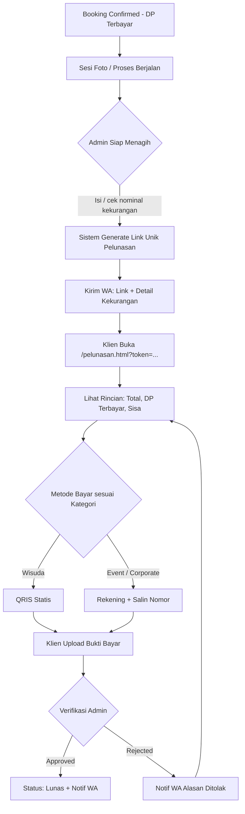

# 💰 Scale-Up: Pelunasan, Penagihan & Analisis Marketing (Jadiphoto.Moment)

Dokumen ini adalah **tambahan** dari `FLOW-SISTEM.md`. Isinya hanya fitur baru: pelunasan & penagihan via link unik, metode pembayaran dinamis per kategori (QRIS statis / rekening), CRUD booking admin, dan analisis sumber informasi klien di dashboard.

---

## 🎯 Ringkasan Fitur

| # | Fitur | Aktor | Ringkasan |
|---|---|---|---|
| 1 | Tagihan Pelunasan via Link Unik | Admin → Klien | Admin kirim link + detail kekurangan lewat WhatsApp |
| 2 | Metode Pembayaran Dinamis | Klien | QRIS statis (Wisuda) / Rekening + tombol salin (Event & Corporate) |
| 3 | Verifikasi Pelunasan | Admin | Approve / reject bukti bayar, status booking menjadi `lunas` |
| 4 | CRUD Daftar Booking | Admin | Tambah, lihat, ubah, batalkan (soft delete) booking |
| 5 | Sumber Informasi Klien | Klien & Admin | Field "Tahu Jadiphoto dari mana?" + analisis di dashboard |

---

## 🗺️ Diagram Alur Pelunasan



> Admin bebas memilih **kapan** tagihan dikirim (sebelum sesi, setelah sesi, atau setelah seleksi foto). Sistem tidak memaksa urutan, hanya menyediakan status dan notifikasi.

---

## 1️⃣ Tagihan Pelunasan via Link Unik

### Sisi Admin
Lokasi: halaman detail booking di `/admin/bookings.html`, tombol **"Kirim Tagihan Pelunasan"**.

Form berisi:
- **Total tagihan** (otomatis dari harga paket, bisa diubah untuk tambahan foto/cetak/diskon)
- **DP terbayar** (otomatis dari data pembayaran DP yang sudah disetujui)
- **Sisa kekurangan** (otomatis terhitung: total − DP)
- **Catatan** (opsional, tampil di halaman klien)
- Tombol **"Generate & Kirim ke WA"**

### Sisi Klien
Halaman publik `/pelunasan.html?token={token}` (tanpa login, pola sama dengan token galeri sortir):
1. Ringkasan booking (paket, tanggal acara)
2. Total tagihan, DP terbayar, **Sisa kekurangan** (ditonjolkan)
3. Instruksi pembayaran sesuai kategori (lihat bagian 2)
4. Form upload bukti bayar (reuse komponen upload DP: `/api/upload/file`, JPG/PNG/PDF maks 5MB)
5. Setelah upload: tampil status "Menunggu verifikasi"

### Template WhatsApp
```
💰 *Tagihan Pelunasan - Jadiphoto.Moment*
Halo {nama_klien}, berikut rincian pelunasan booking Anda:

Paket: {nama_paket}
Total Tagihan: Rp{total}
DP Terbayar: Rp{dp}
*Sisa Kekurangan: Rp{sisa}*

Silakan selesaikan pembayaran melalui link berikut:
🔗 {link_pelunasan}

Terima kasih 🙏
```

Template tambahan: **pelunasan diterima** ("Pembayaran Anda sudah kami terima") dan **bukti ditolak** (disertai alasan + link yang sama untuk upload ulang).

### Aturan Penting
- Token acak panjang (min. 32 karakter), unik, tidak bisa ditebak.
- Satu booking boleh punya lebih dari satu tagihan (misalnya tagihan tambahan). Tagihan lama yang belum dibayar bisa **dibatalkan** admin sebelum membuat yang baru.
- Link hanya bisa upload bukti selama status `sent` atau `rejected`. Setelah `lunas`, halaman berubah menjadi tampilan "Sudah Lunas" (read-only).

---

## 2️⃣ Metode Pembayaran Dinamis per Kategori

Berlaku untuk **DP maupun pelunasan** (satu komponen yang dipakai ulang).

| Kategori Paket | Metode Ditampilkan |
|---|---|
| Wisuda | **QRIS statis**: gambar QR + instruksi "Scan lalu masukkan nominal Rp{sisa}" |
| Event, Corporate | **Rekening bank**: nama bank, nomor rekening, atas nama + tombol **📋 Salin** |
| Kategori lain (Wedding, Prewedding, Studio, dll) | *Usulan:* tampilkan keduanya, klien pilih salah satu (bisa diatur per kategori nanti) |

### QRIS Statis (tanpa payment gateway)
- Admin upload **1 gambar QRIS** di pengaturan, dipakai semua transaksi Wisuda.
- Klien mengisi nominal sendiri saat scan → wajib diberi **nominal yang jelas dan mudah disalin** di halaman agar tidak salah ketik.
- Verifikasi tetap manual lewat bukti bayar, tanpa webhook.

### Rekening Bank
- Admin mengisi nama bank, nomor rekening, atas nama di pengaturan (bisa lebih dari satu rekening).
- Tombol salin memakai `navigator.clipboard.writeText()` dengan notifikasi "Nomor rekening disalin".

### Pengaturan Admin
Halaman baru atau tab di `/admin/categories.html`: **Pengaturan Pembayaran**
- Upload gambar QRIS
- Daftar rekening bank (tambah/ubah/nonaktifkan)
- Aturan metode per kategori (default sesuai tabel di atas)

---

## 3️⃣ Verifikasi Pelunasan (Admin)

Lokasi: `/admin/bookings.html` (detail booking) atau antrian khusus "Menunggu Verifikasi".

1. Admin melihat bukti bayar + nominal yang seharusnya.
2. **Approve** → tagihan `lunas`, booking `lunas`, pemasukan otomatis tercatat di `finance.html`, WA konfirmasi terkirim.
3. **Reject** → wajib isi alasan, status `rejected`, WA berisi alasan + link untuk upload ulang.

### Usulan Status Booking (tambahan)
```
confirmed → menunggu_pelunasan → pelunasan_review → lunas → completed
```
Status `completed` tetap dipicu oleh flow editing/pengiriman hasil foto yang sudah ada.

---

## 4️⃣ CRUD Daftar Booking (Admin)

| Operasi | Endpoint | Catatan |
|---|---|---|
| Create | `POST /api/bookings` | Admin input manual (klien booking via chat/telepon/datang langsung) |
| Read | `GET /api/bookings` | Filter: status, kategori, rentang tanggal, sumber informasi. Search: nama / nomor WA |
| Update | `PUT /api/bookings/:id` | Edit detail, ubah status, reschedule |
| Delete | `DELETE /api/bookings/:id` | **Soft delete** (status `cancelled`/`archived`), data pembayaran tidak hilang |

Tambahan di detail booking: riwayat pembayaran (DP & pelunasan), daftar tagihan terkirim, tombol kirim ulang WA.

---

## 5️⃣ Analisis Sumber Informasi (Dashboard Marketing)

### Pertanyaan di Form Booking
**"Tahu Jadiphoto dari mana?" \*** (wajib)
- Instagram
- TikTok
- Google Search
- Rekomendasi teman/keluarga
- Event / pameran
- Lainnya (isian teks)

Opsional: jika memilih "Rekomendasi", tampilkan kolom "Direkomendasikan oleh siapa?".

### Widget di `/admin/dashboard.html`
- **Distribusi sumber:** pie/bar chart persentase tiap channel (filter rentang tanggal & kategori).
- **Tren bulanan:** channel mana yang naik atau turun.
- **Sumber vs nilai booking:** rata-rata dan total nominal per channel (untuk menentukan prioritas budget marketing).
- **Konversi per channel** (opsional): jumlah booking yang sampai `lunas` dibanding yang batal.

---

## 🗄️ Skema Database

```sql
-- Kolom tambahan di bookings
ALTER TABLE bookings ADD COLUMN sumber_informasi VARCHAR(20);        -- instagram|tiktok|google|referral|event|lainnya
ALTER TABLE bookings ADD COLUMN sumber_informasi_detail TEXT;        -- isian "lainnya" / nama perekomendasi
ALTER TABLE bookings ADD COLUMN deleted_at TIMESTAMP NULL;           -- soft delete

-- Tagihan pelunasan
CREATE TABLE pelunasan (
  id              SERIAL PRIMARY KEY,
  booking_id      INT NOT NULL REFERENCES bookings(id),
  token           VARCHAR(64) UNIQUE NOT NULL,
  total_tagihan   NUMERIC(12,0) NOT NULL,
  dp_terbayar     NUMERIC(12,0) NOT NULL,
  sisa_kekurangan NUMERIC(12,0) NOT NULL,
  catatan         TEXT,
  metode          VARCHAR(20),          -- qris_statis | transfer_bank
  status          VARCHAR(25) NOT NULL DEFAULT 'sent',
                  -- sent | menunggu_verifikasi | lunas | rejected | cancelled
  bukti_file_url  TEXT,
  reject_reason   TEXT,
  sent_to_wa      VARCHAR(20),
  sent_at         TIMESTAMP,
  paid_at         TIMESTAMP,
  verified_by     INT,
  created_by      INT,
  created_at      TIMESTAMP DEFAULT NOW()
);

-- Pengaturan pembayaran
CREATE TABLE payment_settings (
  id          SERIAL PRIMARY KEY,
  qris_image_url TEXT
);

CREATE TABLE bank_accounts (
  id            SERIAL PRIMARY KEY,
  nama_bank     VARCHAR(50) NOT NULL,
  no_rekening   VARCHAR(40) NOT NULL,
  atas_nama     VARCHAR(100) NOT NULL,
  is_active     BOOLEAN DEFAULT TRUE
);
```

> Jika ingin riwayat DP dan pelunasan seragam di satu tempat (untuk `finance.html`), pertimbangkan tabel `payments` dengan kolom `type` (`dp` | `pelunasan`). Tabel `pelunasan` di atas bisa tetap dipakai sebagai "tagihan" dan menulis ke `payments` saat disetujui.

---

## 🔌 Endpoint API Baru

### Publik (berbasis token)
```
GET  /api/pelunasan/:token            → detail tagihan + metode bayar
POST /api/pelunasan/:token/upload     → upload bukti bayar
```

### Admin (JWT)
```
POST /api/pelunasan                   → buat tagihan + generate token
GET  /api/pelunasan?booking_id=       → daftar tagihan per booking
PUT  /api/pelunasan/:id/verify        → approve / reject (alasan wajib jika reject)
PUT  /api/pelunasan/:id/cancel        → batalkan tagihan
POST /api/pelunasan/:id/send-wa       → kirim / kirim ulang ke WA

GET  /api/settings/payment            → ambil QRIS + rekening
PUT  /api/settings/payment            → ubah pengaturan pembayaran
GET  /api/dashboard/sumber-informasi  → data analisis marketing
```

---

## 🖥️ Halaman Baru / Diubah

| Halaman | Status | Keterangan |
|---|---|---|
| `/pelunasan.html` | Baru | Halaman klien (token), rincian + bayar + upload |
| `/admin/payment-settings.html` | Baru | QRIS & rekening |
| `/admin/bookings.html` | Diubah | CRUD lengkap, tombol tagihan, riwayat pembayaran |
| `/admin/dashboard.html` | Diubah | Widget sumber informasi |
| `/booking.html` | Diubah | Tambah field sumber informasi |
| `/admin/finance.html` | Diubah | Pemasukan pelunasan tercatat otomatis |

---

## ✅ Urutan Pengerjaan yang Disarankan

1. **Skema DB** + migrasi (kolom bookings, tabel pelunasan, pengaturan pembayaran)
2. **Pengaturan pembayaran** (QRIS + rekening) dan komponen metode bayar yang bisa dipakai ulang
3. **Pelunasan:** endpoint, halaman `/pelunasan.html`, upload bukti, verifikasi admin
4. **Notifikasi WA** (tagihan, diterima, ditolak)
5. **CRUD booking** lengkap + soft delete
6. **Field sumber informasi** di form booking + widget dashboard
7. **Integrasi finance** (pemasukan pelunasan otomatis)

---

## ⚠️ Catatan Teknis

- **Keamanan token:** rate-limit endpoint publik pelunasan, jangan tampilkan data sensitif klien selain yang perlu (nama, paket, nominal).
- **Nominal di server:** `sisa_kekurangan` dihitung dan disimpan di server, klien tidak bisa mengubahnya.
- **Idempotensi WA:** simpan `sent_at` dan jumlah kirim agar kirim ulang tidak membingungkan klien.
- **QRIS statis:** karena nominal diketik manual, cocokkan nominal bukti bayar dengan tagihan saat verifikasi.
- **Backup bukti bayar:** file di Vercel Blob tetap terhubung ke record `pelunasan`, jangan dihapus saat soft delete booking.
